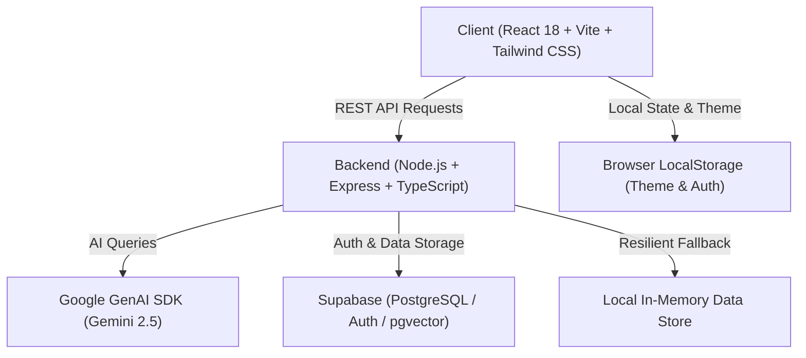

# 🚀 CodeAlpha Portfolio — Enterprise Full-Stack & AI Systems Showcase Platform

[](https://www.typescriptlang.org/)
[](https://react.dev/)
[](https://nodejs.org/)
[](https://tailwindcss.com/)
[](https://ai.google.dev/)
[](LICENSE)

An end-to-end, high-performance Developer Portfolio & Autonomous AI Systems Showcase Platform built for **Kairos Vance** — Senior Full-Stack Engineer and Autonomous AI Systems Architect.

Designed with an architectural engineering aesthetic, strict end-to-end type safety, fluid micro-interactions, an interactive conversational AI assistant (**Aegis**), and an authenticated administrative CMS.

---

## 🌟 Key Highlights & Features

### 🌓 Dual-Theme Design Engine
- **Luxury Monochrome (Dark Mode)**: Void obsidian (`#050505`) backdrop, frosted obsidian glass panels, hairline titanium borders (`white/10`), and crisp high-contrast accents.
- **Minimalist Clean Light (Light Mode)**: Pure crisp white / faint zinc (`#ffffff` / `#f8f9fa`) canvas, clean zinc borders (`#e4e4e7`), jet black headings (`#09090b`), and dark charcoal body typography.
- **Persistent Toggle**: Accessible navbar button with animated Sun/Moon icons, synchronized seamlessly with `localStorage` and system OS color preference fallback.

### 🤖 Aegis AI Assistant
- Interactive floating conversational assistant grounded in Kairos Vance's architectural experience, technical competencies, and project portfolio.
- Powered by the `@google/genai` SDK (Gemini 2.5 Flash / Pro) with resilient local algorithmic fallback when API keys are unconfigured.
- **Context-Aware Case Study Interrogation**: One-click deep-dive questions directly from project cards and case study detail views.

### 💼 Architectural Project Showcase & Deep Dives
- Interactive grid filtering across **AI Systems**, **Full Stack**, and **Distributed Infrastructure**.
- Detailed case study modal and dedicated route pages (`/projects/:slug`) detailing:
  - System scope & architecture topology diagrams
  - Technical bottlenecks & engineered resolutions
  - Integrated production technologies & metrics
  - Live system demo & repository links

### 📊 Live Skill Matrix
- Real-time categorized proficiency explorer covering **Languages**, **Frontend**, **Backend**, **AI / Machine Learning**, and **Cloud & DevOps**.
- Interactive keyword search, fluency meters, and featured competence badges.

### 📄 Interactive & Printable Resume Deliverable (`/resume`)
- In-browser interactive resume sheet with high-fidelity print styles (`window.print()`) tuned for zero-loss, crisp black-and-white PDF saving.
- One-click downloads for **Raw Markdown (`.md`)** and **Structured JSON (`.json`)**.

### 🔒 Authenticated Admin CMS Portal (`/admin/login` & `/admin/dashboard`)
- Full administrative CRUD suite to manage projects and skills in real time.
- Direct message inbox to inspect and mark incoming client inquiries as read.
- Powered by Supabase Auth with fallback local credentials for offline preview (`admin@kairosvance.dev` / `kairosvance2025`).

### 📬 Validated Contact & Inquiry Dispatch Engine
- End-to-end input validation using strict Zod schemas with rate-limiting and anti-spam protection.
- Quick direct channel buttons (Email, LinkedIn, GitHub, Twitter) with copy-to-clipboard feedback.

---

## 🏗️ Architecture & Tech Stack



### Frontend Architecture
- **Framework**: React 18+ with Vite
- **Routing**: React Router DOM (v6)
- **Styling**: Tailwind CSS, CSS Custom Properties, Glassmorphism
- **Icons**: Lucide React
- **Validation**: Zod + React Hook Form patterns

### Backend Architecture
- **Runtime**: Node.js & TypeScript
- **Framework**: Express.js
- **Validation**: Zod request schema validation middleware
- **Security & Utilities**: CORS, Rate Limiting, dotenv
- **AI Integration**: `@google/genai` (Gemini API)

---

## 📂 Project Directory Structure

```text
CodeAlpha_Portfolio/
├── client/                     # Vite + React Frontend Application
│   ├── public/                 # Static assets & favicons
│   ├── src/
│   │   ├── components/         # Modular component hierarchy
│   │   │   ├── about/          # Engineering philosophy & background
│   │   │   ├── admin/          # Admin CMS management tables & sidebar
│   │   │   ├── ai-chat/        # Aegis AI conversational assistant
│   │   │   ├── common/         # Navbar, Footer, Buttons, Monogram
│   │   │   ├── contact/        # Contact form & direct channels
│   │   │   ├── hero/           # Hero headline & interactive terminal
│   │   │   ├── projects/       # Project grid, cards, case study modal
│   │   │   ├── skills/         # Categorized skill matrix & search
│   │   │   └── timeline/       # Career milestones & certifications
│   │   ├── context/            # ThemeContext & global state
│   │   ├── hooks/              # Custom React hooks (useAIAssistant, etc.)
│   │   ├── lib/                # API client & Supabase helpers
│   │   ├── pages/              # Route views (Home, Resume, ProjectDetail, Admin)
│   │   ├── styles/             # Global CSS & Tailwind utilities
│   │   ├── types/              # End-to-end TypeScript definitions
│   │   ├── App.tsx             # Root router & layout configuration
│   │   └── main.tsx            # React DOM bootstrap
│   ├── .env.example            # Client environment template
│   ├── package.json
│   ├── tailwind.config.js
│   └── vite.config.ts
├── server/                     # Node.js + Express Backend API Engine
│   ├── src/
│   │   ├── config/             # Supabase & AI clients
│   │   ├── controllers/        # Route controllers (projects, skills, AI, contact)
│   │   ├── middleware/         # Auth, validation, and error handlers
│   │   ├── routes/             # RESTful API route definitions
│   │   ├── schemas/            # Zod validation schemas
│   │   ├── seed/               # Initial portfolio data & project case studies
│   │   ├── types/              # Server-side TypeScript interfaces
│   │   └── index.ts            # Express server initialization
│   ├── .env.example            # Server environment template
│   ├── package.json
│   └── tsconfig.json
├── supabase/                   # Supabase schema definitions
│   └── schema.sql              # PostgreSQL DDL & Row Level Security (RLS) policies
├── .gitignore                  # Git ignore rules
├── package.json                # Root orchestrator scripts
└── README.md                   # Project documentation
```

---

## ⚡ Quick Start & Local Setup

### 1. Clone the Repository
```bash
git clone https://github.com/shrirajmaske-dev/CodeAlpha_Portfolio.git
cd CodeAlpha_Portfolio
```

### 2. Install All Dependencies
```bash
# Install root, backend, and frontend dependencies
npm run install:all
```

### 3. Configure Environment Variables

**Backend (`server/.env`):**
```bash
cp server/.env.example server/.env
```
Fill in the following values (or leave blank to use the built-in resilient storage):
```env
PORT=5001
NODE_ENV=development
CLIENT_ORIGIN=http://localhost:5173

# Optional: Supabase Credentials (leave blank to run in resilient local mode)
SUPABASE_URL=
SUPABASE_SERVICE_ROLE_KEY=

# Optional: Google Gemini API Key (get from https://aistudio.google.com/)
GEMINI_API_KEY=
```

**Frontend (`client/.env`):**
```bash
cp client/.env.example client/.env
```
```env
VITE_API_BASE_URL=http://localhost:5001/api/v1
VITE_SUPABASE_URL=
VITE_SUPABASE_ANON_KEY=
```

### 4. Start Development Servers
Run both backend and frontend concurrently:
```bash
npm run dev
```

- **Frontend Client**: [http://localhost:5173](http://localhost:5173)
- **Backend API Server**: [http://localhost:5001](http://localhost:5001)
- **API Health Check**: [http://localhost:5001/health](http://localhost:5001/health)

---

## 🔑 Admin Credentials (Local Preview)

To access the Admin CMS Portal at `http://localhost:5173/admin/login`:
- **Email**: `admin@kairosvance.dev`
- **Password**: `kairosvance2025`

---

## 📡 API Reference Overview

All REST API endpoints are prefixed with `/api/v1`:

| Method | Endpoint | Description | Auth Required |
| :--- | :--- | :--- | :--- |
| `GET` | `/health` | Server status and uptime verification | No |
| `GET` | `/api/v1/projects` | Fetch all active project case studies | No |
| `GET` | `/api/v1/projects/:slug`| Fetch single project case study by slug | No |
| `GET` | `/api/v1/skills` | Fetch all categorized skills & groupings | No |
| `POST` | `/api/v1/contact` | Submit inquiry form with Zod validation | No |
| `POST` | `/api/v1/ai/chat` | Query the Aegis AI Assistant | No |
| `POST` | `/api/v1/admin/projects` | Create a new project case study | Yes (Bearer) |
| `PUT` | `/api/v1/admin/projects/:id` | Update project case study | Yes (Bearer) |
| `DELETE` | `/api/v1/admin/projects/:id` | Delete project case study | Yes (Bearer) |
| `POST` | `/api/v1/admin/skills` | Create a new technical skill entry | Yes (Bearer) |
| `PUT` | `/api/v1/admin/skills/:id` | Update skill proficiency or details | Yes (Bearer) |
| `DELETE` | `/api/v1/admin/skills/:id` | Delete a skill entry | Yes (Bearer) |
| `GET` | `/api/v1/admin/messages` | List all inquiries received | Yes (Bearer) |
| `PATCH` | `/api/v1/admin/messages/:id/read` | Mark inquiry message as read | Yes (Bearer) |
| `DELETE` | `/api/v1/admin/messages/:id` | Delete an inquiry message | Yes (Bearer) |

---

## 🛠️ Build & Production Deployment

To create an optimized production build locally:
```bash
# Builds the production client bundle
npm run build

# Or build both server and client
npm run build:all
```

The compiled frontend output will be in `client/dist/`, and backend compiled files in `server/dist/`.

---

## ☁️ Deploying on Vercel

This repository is pre-configured for **zero-configuration deployment on Vercel**:

1. Push this repository to GitHub.
2. In the [Vercel Dashboard](https://vercel.com/new), click **Add New...** &rarr; **Project**.
3. Import your `CodeAlpha_Portfolio` repository.
4. Leave all build and install settings as default — Vercel will automatically read `vercel.json`:
   - **Install Command**: `npm run install:all` (also triggered via `postinstall`)
   - **Build Command**: `npm run build`
   - **Output Directory**: `client/dist`
   - **SPA Routing**: Handled via automatic `/index.html` rewrites
5. Click **Deploy**!

> **Note on Full-Stack Mode**: The frontend operates seamlessly in standalone mode with built-in architectural case studies, offline AI reasoning, and persistent client-side storage. If you host the backend Express server (e.g. on Render, Railway, or Fly.io), simply add the `VITE_API_BASE_URL` environment variable in your Vercel Project Settings.

---

## 📄 License

This project is licensed under the MIT License — see the [LICENSE](LICENSE) file for details.
